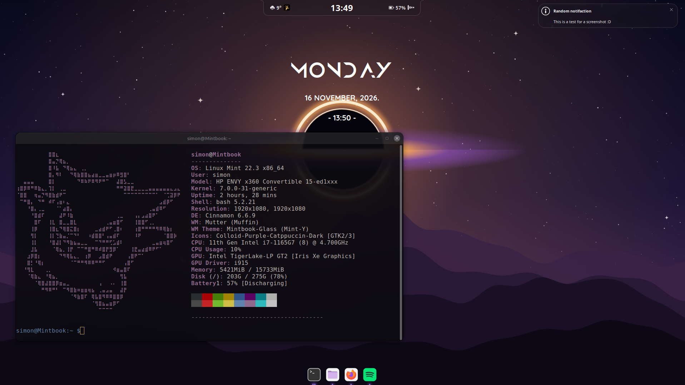
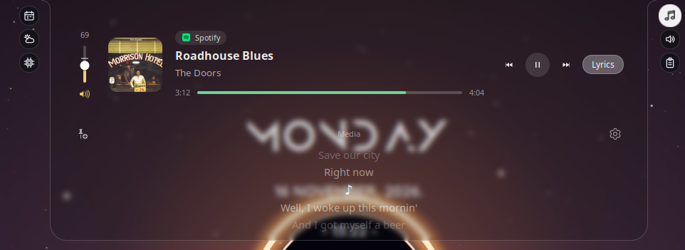
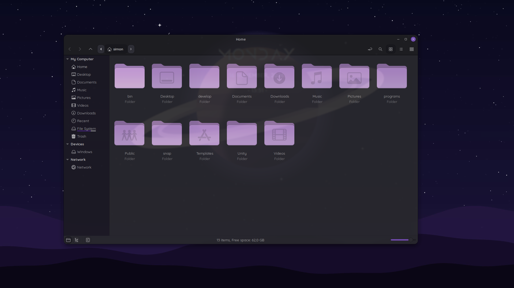
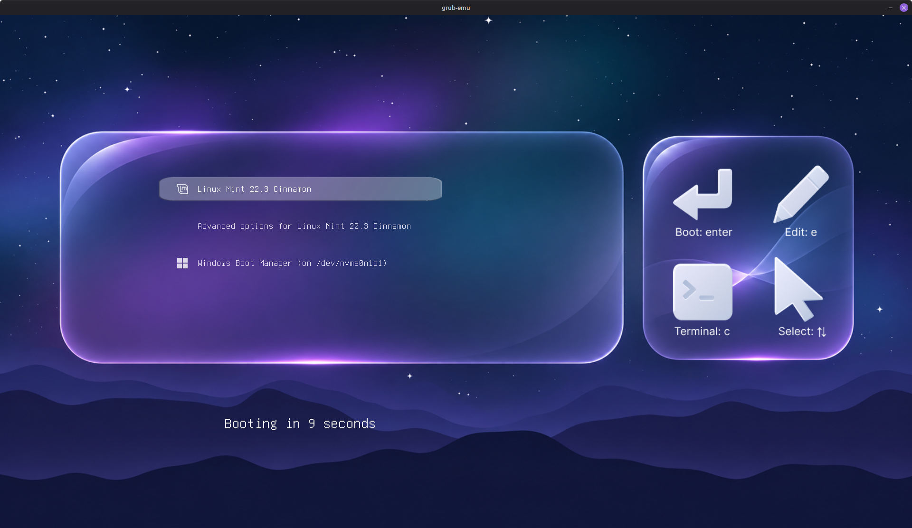

# Mint Rice

A glassmorphism-inspired **Linux Mint Cinnamon** desktop, customized with translucent windows, rounded corners, a persistent Dynamic Island-style status bar, a minimal Plank dock, and a matching GRUB boot menu.

> [!NOTE]
> This repository currently contains a **snapshot of my personal desktop configuration**, not a finished one-command installer. The setup is tailored to my hardware and monitor arrangement. Review all scripts and configuration files before applying them on another machine.



## Screenshots

| Cinnamon Island | Nemo file manager |
|:---:|:---:|
|  |  |



## Features

- **Cinnamon desktop:** custom `Mintbook-Glass` shell theme, panel layout, applets, Alt-Tab switcher, and rounded notifications.
- **Cinnamon Island:** modified extension with persistent clock, weather, battery display, custom tab icons, and layout adjustments.
- **Window effects:** Blur Cinnamon and Rounded Corners, including transparency and blur for selected applications.
- **Plank:** minimal application dock with pinned launchers and exported preferences.
- **Nemo:** GTK styling, transparency, and **Colloid Purple Catppuccin Dark** icons.
- **GRUB:** customized Liquid-GRUB theme and background for a Linux Mint / Windows dual-boot menu (optional manual activation).
- **Terminal:** shell preferences, terminal profiles, and a customized Neofetch ASCII-art configuration.
- **btop:** custom `darkshadow.theme`, panel layout and Braille graphs.
- **Conky:** multiple widgets with multi-monitor wallpaper and startup scripts.
- **Wallpapers:** three space-themed backgrounds from [DarkShadowShell](https://github.com/shadowww-dev/DarkShadowShell), with attribution and the upstream MIT license included.

## Tested environment

| Component | Setup |
|---|---|
| OS | Linux Mint 22.3 Zena |
| Desktop | Cinnamon 6.6, X11 |
| Device | HP Envy x360 |
| Displays | Internal display with optional external monitors |
| Boot | Linux Mint and Windows 11 (dual boot) |

## Repository layout

```text
assets/wallpapers/       Three attributed DarkShadowShell space wallpapers
autostart/               Monitor detection, wallpaper and startup scripts
cinnamon/applets/        Exported applet settings
cinnamon/configs/        Cinnamon extension settings
cinnamon/dconf/          Cinnamon desktop settings
cinnamon/island/         Customized Cinnamon Island extension
cinnamon/themes/         Mintbook-Glass Cinnamon theme
conky/                   Conky configuration and widgets
btop/                    btop config and DarkShadow theme
grub/theme/              Customized GRUB theme and background
nemo/                    Nemo preferences and GTK CSS
plank/                   Dock preferences and pinned applications
terminal/                Shell, terminal, and Neofetch configuration
scripts/export.sh        Export desktop configuration
install.sh                Preview/optional user configuration installer
restore.sh                Restore backed-up user config
autostart/runtime/        Portable wallpaper/Conky monitor watcher
scripts/audit.py         Heuristic privacy / portability audit
screenshots/             Gallery images used in this README
```

## First installer (preview)

The installer is intentionally cautious. **It previews operations unless you pass `--apply`**, makes backups of overwritten user files and dconf, and deliberately avoids importing the raw Cinnamon panel/keybinding snapshot.

```bash
git clone https://github.com/simontrost/mint-rice.git
cd mint-rice
./install.sh --dry-run
./install.sh --apply --install-packages --with-desktop
```

**Requirements:** Linux Mint Cinnamon 6.x on X11, and an existing Cinnamon session. Some modules require the original programs to be installed (Plank, btop, feh, Conky, etc.). The above command installs apt dependencies, but does **not** install Colloid, the Island engine, the referenced fonts/cursor theme or every external Cinnamon extension automatically.

For Colloid Purple Catppuccin Dark:

```bash
git clone https://github.com/vinceliuice/Colloid-icon-theme.git ~/dev/repos/Colloid-icon-theme
cd ~/dev/repos/Colloid-icon-theme
./install.sh -t purple -s catppuccin
```

The **Cinnamon Island engine** is a separate Python service not bundled in this snapshot. On a fresh machine, the installer can clone the pinned upstream v0.1.0 engine source and set up a user service (requires network access):

```bash
./install.sh --apply --only island --install-island-engine
```

Enable Cinnamon Island, Blur Cinnamon and Rounded Corners in **System Settings → Extensions**. The standard Mint-Y-Dark-Purple GTK theme is expected to be installed. Fonts (Quicksand, Gotham/Montserrat as appropriate), `LyraQ-cursors`, and icon/cursor resources are not bundled.

For a single component:

```bash
./install.sh --apply --only btop
./install.sh --apply --only nemo
./install.sh --apply --only island
```

Dangerous or hardware-specific operations are opt-in:

```bash
./install.sh --dry-run --with-bashrc --with-autostart --with-grub
./install.sh --apply --with-autostart
./install.sh --apply --with-grub
```

- `--with-bashrc` **replaces** the current `.bashrc` after backing it up. Not recommended for general users; merge manually instead.
- `--with-autostart` enables a new **portable** watcher. It does not enable a duplicate if the legacy `Watch display.desktop` exists. Configure `~/.config/mint-rice/monitors.conf` from `autostart/monitors.example.conf`. Wallpaper order with `feh` on multiple screens may still need user adjustments.
- `--with-grub` **copies theme files only** to `/boot/grub/themes/Mintbook-Glass/` and never edits `/etc/default/grub`, EFI files, or GRUB boot entries. If the destination exists, it is not overwritten. Activate manually only after verifying your GRUB configuration and Windows Boot Manager entry.
- `--with-desktop` sets only the GTK, icons and Cinnamon theme names; it never imports panel layout or broken custom keybindings.
- The saved `cinnamon/dconf/cinnamon.ini` and `terminal/gnome-terminal.ini` are snapshots for **manual review**. Applying the complete dumps can overwrite unrelated configuration and machine-specific paths.

Each installation prints its backup directory. Preview a restore and then apply:

```bash
./restore.sh
./restore.sh --apply
```

Restoration reverses backed-up user files and dconf changes. It does **not** uninstall apt packages, remove any downloaded Island engine, or remove manually copied GRUB assets.

### Refresh source-machine configuration

```bash
./scripts/export.sh
python3 scripts/audit.py
```

The exporter is for the **source machine** only. Audit is heuristic: personally review all exported files before publishing, including asset attribution and private URLs.

### Known limitations

- Full Cinnamon panel placement, extension activation, hotkeys and monitor geometry are *not* safely auto-restored.
- Colloid, Quicksand and custom cursors need separate installation; the shipped style may fall back if they are missing.
- Third-party assets and original licenses require manual provenance review; see [THIRD_PARTY.md](THIRD_PARTY.md).
- Window-Blur and GTK-specific effects depend on compatible extensions and installed application versions.

## Upstream projects and credits

This setup builds on third-party software and themes; the original projects remain the authoritative source for installation instructions and licenses:

- [Linux Mint / Cinnamon](https://linuxmint.com/)
- [Cinnamon Island](https://github.com/rovillela-afk/cinnamon-island) (modified extension)
- [Blur Cinnamon](https://github.com/klangman/BlurCinnamon)
- [Rounded Corners](https://cinnamon-spices.linuxmint.com/extensions/view/117)
- [Colloid Icon Theme](https://github.com/vinceliuice/Colloid-icon-theme)
- [Liquid-GRUB](https://github.com/Purp1eDuck2008/Liquid-GRUB) (modified GRUB visuals)
- [DarkShadowShell](https://github.com/shadowww-dev/DarkShadowShell) (space wallpapers; source files `space-black-hole.jpg`, `space-planet.jpg`, `space-galaxy.jpg`; see `assets/wallpapers/LICENSE.DarkShadowShell`)
- [Plank](https://launchpad.net/plank)
- [Flameshot](https://flameshot.org/)
- [Now Clocking / Conky setup](https://github.com/simontrost/conky-rainmeter-mond)

The DarkShadowShell source repository is MIT-licensed, and a copy of its license accompanies the three space wallpapers. Other third-party files, fonts, and artworks remain subject to their respective rights and licenses. Their presence in this repository does not imply ownership or permission to redistribute them. **Review licenses and asset provenance before publishing the repository.**

## Security and portability

- **Never commit** calendar subscription URLs, passwords, tokens, keys, or machine-specific secrets.
- Check exported Cinnamon Island settings, terminal configuration, and autostart scripts before pushing.
- The included audit is heuristic and cannot guarantee that all sensitive content has been found.
- This repository is a snapshot, so some paths, display names, and settings are specific to the original machine.

## Status

Configuration export: **available** · Preview installer: **available** · User-file backup / restore: **available** · Full machine-independent restoration: **work in progress**
